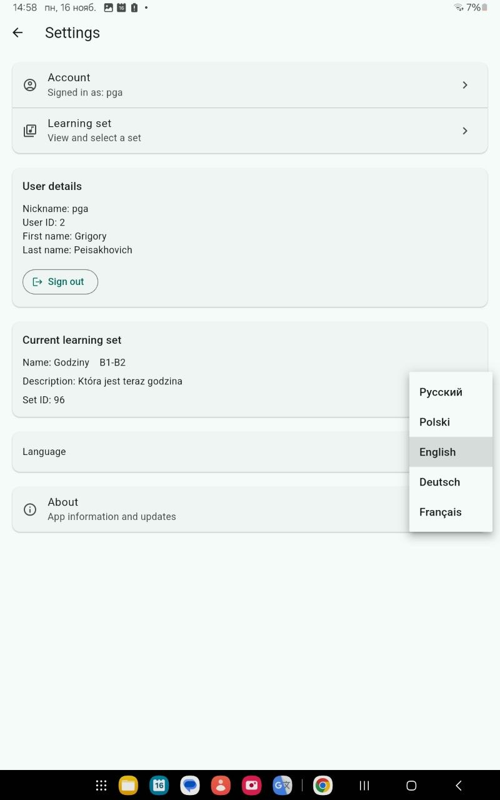
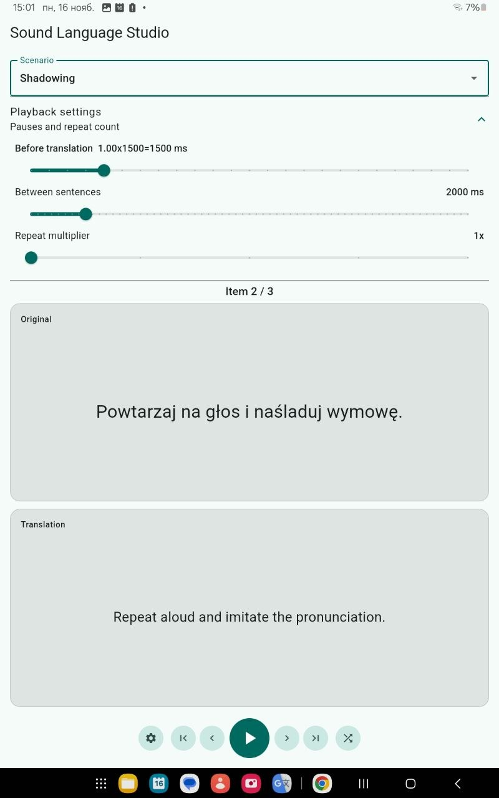
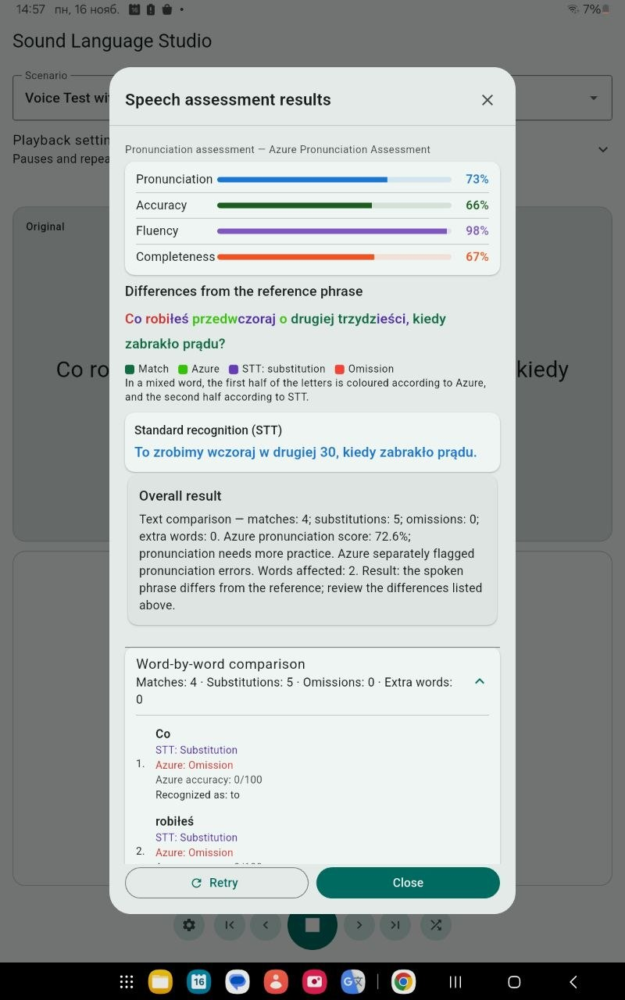

# Sound Language Studio — Mobile Application

**Sound Language Studio** is a language-learning application that combines interactive audio training with speaking practice.

The **Shadowing Mobile** client provides learners with tools to develop listening comprehension, pronunciation, and speaking skills.

The mobile application is part of the Sound Language Studio software suite, which also includes a desktop application for preparing learning materials and a server-side API.

## Who Is the Application For?

Sound Language Studio supports two main learning scenarios.

### Independent Language Learning

Learners can choose the available learning materials and study whenever they want, at their own pace.

The mobile application provides two tools, Shadowing and Speech Test, to practise listening comprehension, pronunciation, and speaking.

Learning materials are prepared in the desktop version of Sound Language Studio and made available to users through the API.

### Organised Learning with a Teacher

Sound Language Studio allows teachers to organise learning for individual students and groups.

Teachers prepare learning materials in the desktop application, create topic-based sets, and assign them to user accounts.

The system offers flexibility in how learning is organised:

- one user account can contain several learning sets;
- separate accounts can be created for different groups, levels, or topics;
- one learner can use multiple accounts when access to different learning materials is required.

User accounts do not necessarily have to represent specific people. They can be used as virtual learning profiles. For example, the first-name and last-name fields can contain a course or group title and a short description of the learning topic. This helps teachers and learners identify the available materials.

Teachers decide how many accounts and learning sets to create and how to combine them according to their teaching methods and learning objectives.

Learners sign in to the mobile application using the credentials provided to them and work with the learning materials available to their accounts.

## Two Main Learning Tools

### 1. Shadowing — Listening and Speech Reproduction Practice

Shadowing helps learners develop listening comprehension, pronunciation, speech rhythm, and fluency. The learner listens to a phrase in the target language, sees its translation, and repeats what they have heard.

The application provides several training options and flexible settings:

- repeating phrases for a specified number of cycles;
- setting the number of repetitions for each learning item;
- adjusting the pause between a phrase and its translation;
- adjusting pauses between learning items;
- random phrase selection (Randomizer);
- playback control using Bluetooth devices.

These settings allow learners to adapt their training to their own pace and preferences.

### 2. Speech Test — Speaking Practice and Assessment

Speech Test is a tool for practical speaking exercises. It helps learners assess their pronunciation and progressively improve their speaking skills.

Learners pronounce the suggested phrases, receive an assessment and analysis of the results, review detected errors, and repeat the exercise to achieve a better result.

The assessment is based on **Microsoft Azure AI Speech**, which uses two processing modes for the same audio recording:

- **Speech-to-Text (STT)** — recognises spoken language and converts it into text.
- **Pronunciation Assessment** — provides a specialised assessment of pronunciation against a reference phrase.

Sound Language Studio's own processing logic compares the results of both modes with the reference text. This helps identify discrepancies, omitted words, and extra words, and provides more informative feedback.

The main goal of Speech Test is not simply to assess pronunciation, but to help learners gradually improve the accuracy, fluency, and confidence of their spoken language.

## Application Screenshots

### Learning Set Selection

Users can access the learning sets assigned to their accounts.



### Shadowing — Main Training Screen



### Training Settings


### Speech Test



## Sound Language Studio Architecture

The software suite consists of three interconnected components.

### Desktop Application — Preparing Learning Materials

The desktop application is designed for teachers and learning-material authors.

It allows users to create and edit learning sets, work with phrases and translations, prepare audio materials, and manage their publication for the mobile application.

[Desktop application repository](https://github.com/peisakhovich/ShatdowingPlayer_SA_03)

[Desktop application documentation](https://peisakhovich.github.io/ShatdowingPlayer_SA_03/)

### API — Server-Side Component

The API connects the desktop application, mobile client, and server resources.

Its main responsibilities include:

- user authentication;
- retrieving information about learning sets and their contents;
- delivering prepared audio materials;
- managing learning-set data;
- processing Speech Test requests and communicating with Microsoft Azure AI Speech.

[API repository](https://github.com/peisakhovich/sa03-api)

### Mobile Application — Learning

The mobile application is designed as a **thin client**.

It is not intended for creating or editing learning materials. Its purpose is to retrieve prepared content through the API, store the required data on the device, and provide learners with tools for their studies.

[Mobile application repository](https://github.com/peisakhovich/shatdowing_mobile)

## Local Storage and Offline Operation

The mobile application downloads a learning set and the required audio files to the device.

This makes it possible to:

- practise with audio without a permanent internet connection;
- open previously downloaded learning materials quickly;
- continue studying when the network is temporarily unavailable;
- retain the current position in a learning session.

When another learning set is downloaded, the application replaces the previous local session only after the new download has completed successfully. If the download fails, the previous session is preserved.

Speech Test requires an internet connection because audio processing is performed by the server component using Microsoft Azure AI Speech.

## Additional Features

- Bluetooth playback control, including support for headset buttons and external devices.
- Saving the current position in a learning session.
- Configurable playback settings.
- Local storage of learning materials and audio files.
- Application updates using an OTA (Over-the-Air) mechanism.

## Installation

The latest Android application version is available on the GitHub Releases page.

**[Download the latest version of Sound Language Studio](https://github.com/peisakhovich/shatdowing_mobile/releases/latest)**

On the release page, download the `app-release.apk` file and install it on your Android device.

## Technologies

The mobile application is developed using **Flutter / Dart**.

Main technologies and libraries:

- **Flutter** — user interface and application logic.
- **just_audio** — audio playback.
- **audio_service** — playback management and integration with system media controls.
- **record** — voice recording for Speech Test.
- **http** — communication with the server API.
- **shared_preferences** — storage of user settings.
- **path_provider** — local file access.
- **wakelock_plus** — keeping the screen awake during training.
- **ota_update** — application update mechanism.

## Development

The Flutter SDK and Dart SDK are required to work with the source code.

Clone the repository and install dependencies:

```bash
git clone https://github.com/peisakhovich/shatdowing_mobile.git
cd shatdowing_mobile
flutter pub get
```

Run the application:

```bash
flutter run
```

Analyse the project:

```bash
flutter analyze
```

Build an Android APK:

```bash
flutter build apk --release
```

## License

Project licensing information will be added separately.
