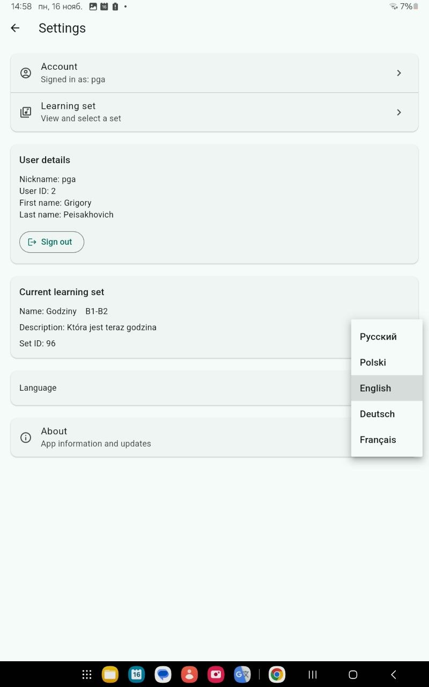
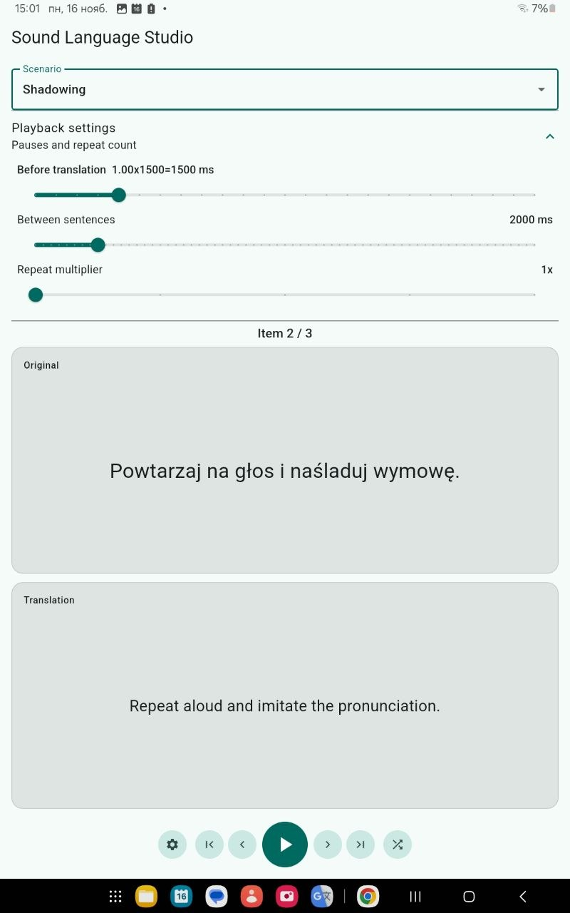
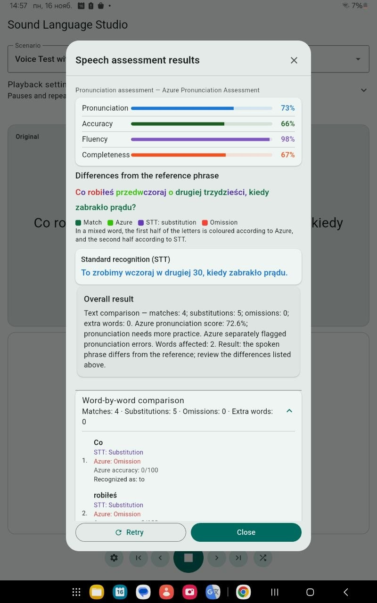

# Sound Language Studio — мобильное приложение

**Sound Language Studio** — приложение для изучения иностранных языков, объединяющее интерактивную аудиотренировку и практику устной речи.

Мобильный клиент **Shadowing Mobile** предоставляет учащемуся инструменты для развития навыков восприятия иностранной речи на слух, произношения и говорения.

Приложение является частью программного комплекса Sound Language Studio, в который также входят настольное приложение для подготовки учебных материалов и серверный API.

## Для кого предназначено приложение

Sound Language Studio поддерживает два основных сценария обучения.

### Самостоятельное изучение языка

Пользователь самостоятельно выбирает доступные учебные материалы и занимается в удобное время и в собственном темпе.

Мобильное приложение предоставляет инструменты Shadowing и Speech Test, позволяя тренировать восприятие речи на слух, отрабатывать произношение и совершенствовать навыки говорения.

Учебные материалы предварительно подготавливаются в настольной части Sound Language Studio и становятся доступны пользователю через API.

### Организованное обучение с преподавателем

Sound Language Studio позволяет преподавателю самостоятельно организовывать учебный процесс для отдельных учащихся и групп.

Преподаватель готовит учебные материалы в настольной части приложения, формирует наборы по нужным темам и распределяет их между учётными записями.

При этом система предоставляет свободу организации обучения:

- одна учётная запись может объединять несколько учебных наборов;
- можно создавать отдельные учётные записи для разных групп, уровней или тематик;
- один учащийся может пользоваться несколькими учётными записями, если ему необходим доступ к разным учебным материалам.

Учётные записи не обязательно должны соответствовать конкретным людям. Их можно использовать как условные учебные профили: например, указывать в полях имени и фамилии название и краткое описание курса, группы или учебной темы. Это помогает преподавателю и учащимся легко ориентироваться в доступных материалах.

Количество учётных записей и наборов, а также способы их сочетания преподаватель определяет самостоятельно — в соответствии со своей методикой и задачами обучения.

Учащиеся входят в мобильное приложение с предоставленными им учётными данными и работают с доступными им учебными материалами.

## Два основных инструмента обучения

### 1. Shadowing — тренировка восприятия и воспроизведения речи

Shadowing помогает развивать понимание речи на слух, произношение, ритм и беглость речи. Учащийся прослушивает фразу на изучаемом языке, знакомится с её переводом и повторяет услышанное.

В приложении предусмотрены различные варианты тренировки и гибкие настройки:

- повторение фраз с заданным количеством циклов;
- настройка количества повторов учебного элемента;
- настройка паузы между фразой и переводом;
- настройка пауз между учебными элементами;
- случайный выбор фраз (Randomizer);
- управление воспроизведением с помощью Bluetooth-устройств.

Настройки позволяют адаптировать тренировку под индивидуальный темп и предпочтения учащегося.

### 2. Speech Test — проверка и совершенствование навыка говорения

Speech Test — инструмент практической тренировки устной речи. Он позволяет не только проверять правильность произношения, но и последовательно оттачивать навык говорения на изучаемом языке.

Учащийся самостоятельно произносит предложенные фразы, получает оценку и анализ результатов, видит ошибки и может повторять упражнение, добиваясь лучшего результата.

В основе проверки лежит **Microsoft Azure AI Speech**, использующий два режима обработки одной аудиозаписи:

- **Speech-to-Text (STT)** — распознавание произнесённой речи и преобразование её в текст.
- **Pronunciation Assessment** — специализированная оценка произношения относительно заданной эталонной фразы.

Собственная интеллектуальная логика Sound Language Studio сопоставляет результаты обоих режимов с эталонным текстом. Это позволяет выявлять расхождения, пропущенные и лишние слова и формировать более информативную обратную связь.

Главная цель Speech Test — не просто оценить произношение, а помочь учащемуся постепенно улучшать точность, беглость и уверенность устной речи.

## Интерфейс приложения

### Выбор учебных материалов

Пользователь получает доступ к учебным наборам, назначенным его учётной записи.



### Shadowing — основной экран тренировки



### Настройки тренировки


### Speech Test



## Архитектура Sound Language Studio

Комплекс состоит из трёх взаимодействующих частей.

### Desktop Application — подготовка учебных материалов

Настольное приложение предназначено для преподавателей и авторов учебных материалов.

Оно позволяет создавать и редактировать учебные наборы, работать с фразами и переводами, подготавливать аудиоматериалы и управлять их публикацией для мобильного приложения.

[Репозиторий настольного приложения](https://github.com/peisakhovich/ShatdowingPlayer_SA_03)

[Документация настольного приложения](https://peisakhovich.github.io/ShatdowingPlayer_SA_03/)

### API — серверная часть

API обеспечивает взаимодействие между настольным приложением, мобильным клиентом и серверными ресурсами.

Основные задачи API:

- авторизация пользователей;
- получение информации об учебных наборах и их содержимом;
- передача подготовленных аудиоматериалов;
- управление данными учебных наборов;
- обработка запросов Speech Test и взаимодействие с Microsoft Azure AI Speech.

[Репозиторий API](https://github.com/peisakhovich/sa03-api)

### Mobile Application — обучение

Мобильное приложение является тонким клиентом (Thin Client).

Оно не предназначено для создания или редактирования учебных материалов. Его задача — получать подготовленное содержание через API, хранить необходимые данные на устройстве и предоставлять учащемуся инструменты для занятий.

[Репозиторий мобильного приложения](https://github.com/peisakhovich/shatdowing_mobile)

## Локальное хранение и работа без интернета

Мобильное приложение загружает учебный набор и необходимые аудиофайлы на устройство.

Это позволяет:

- выполнять аудиотренировки без постоянного подключения к интернету;
- быстро открывать ранее загруженные учебные материалы;
- продолжать занятия при временном отсутствии сети;
- сохранять текущую позицию в учебной сессии.

При загрузке другого учебного набора приложение заменяет предыдущую локальную сессию после успешного завершения новой загрузки. Если загрузка завершается ошибкой, предыдущая сессия сохраняется.

Для работы Speech Test требуется подключение к интернету, поскольку обработка аудиозаписи выполняется серверной частью с использованием Microsoft Azure AI Speech.

## Дополнительные возможности

- Bluetooth-управление воспроизведением, включая поддержку кнопок гарнитур и внешних устройств.
- Сохранение текущей позиции учебной сессии.
- Настройка параметров воспроизведения.
- Локальное хранение учебных материалов и аудиофайлов.
- Обновление приложения через механизм OTA (Over-the-Air).

## Установка

Актуальную версию Android-приложения можно получить на странице GitHub Releases.

**[Скачать последнюю версию Sound Language Studio](https://github.com/peisakhovich/shatdowing_mobile/releases/latest)**

На странице релиза необходимо скачать файл `app-release.apk` и установить его на Android-устройство.

## Технологии

Мобильное приложение разработано на **Flutter / Dart**.

Основные используемые технологии и библиотеки:

- **Flutter** — пользовательский интерфейс и логика приложения.
- **just_audio** — воспроизведение аудио.
- **audio_service** — управление воспроизведением и интеграция с системными медиаконтролами.
- **record** — запись голоса для Speech Test.
- **http** — взаимодействие с серверным API.
- **shared_preferences** — хранение пользовательских настроек.
- **path_provider** — работа с локальными файлами.
- **wakelock_plus** — управление режимом сна экрана во время тренировки.
- **ota_update** — механизм обновления приложения.

## Разработка

Для работы с исходным кодом необходимы Flutter SDK и Dart SDK.

Получение проекта и установка зависимостей:

```bash
git clone https://github.com/peisakhovich/shatdowing_mobile.git
cd shatdowing_mobile
flutter pub get
```

Запуск приложения:

```bash
flutter run
```

Проверка проекта:

```bash
flutter analyze
```

Сборка Android APK:

```bash
flutter build apk --release
```

## Лицензия

Информация о лицензировании проекта будет добавлена отдельно.
